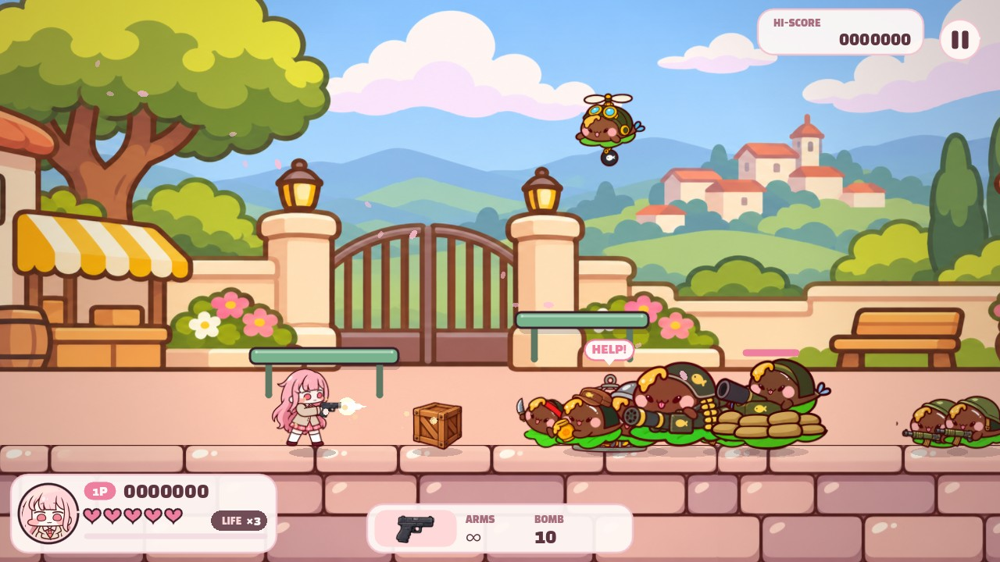
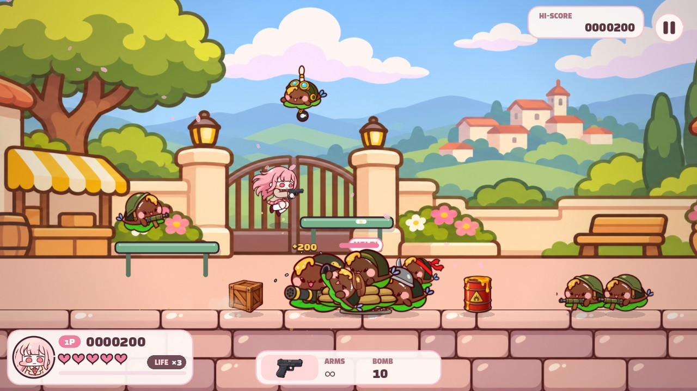
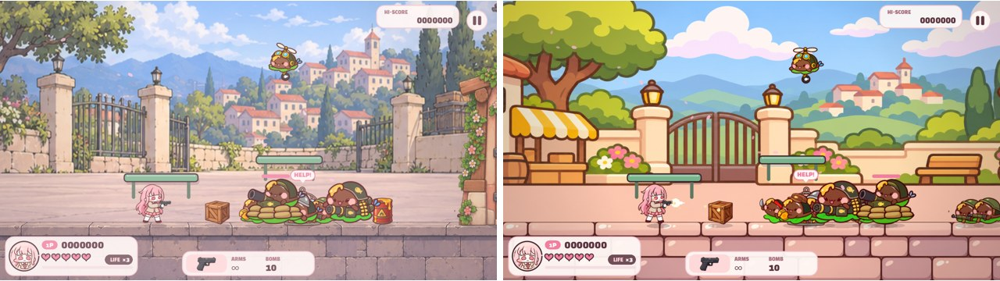
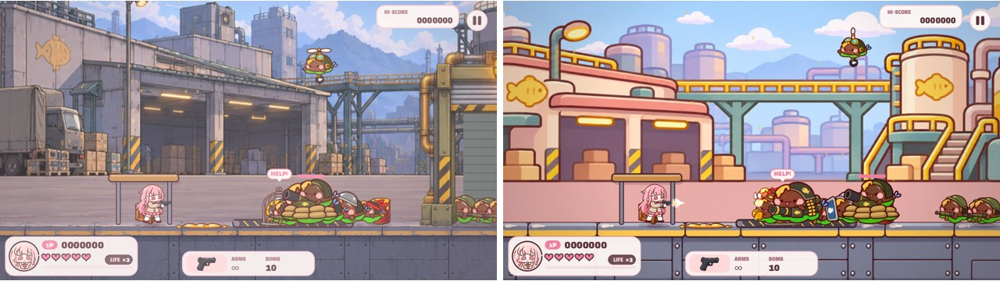
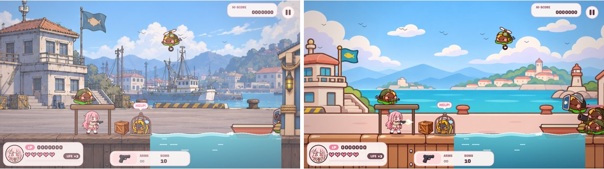
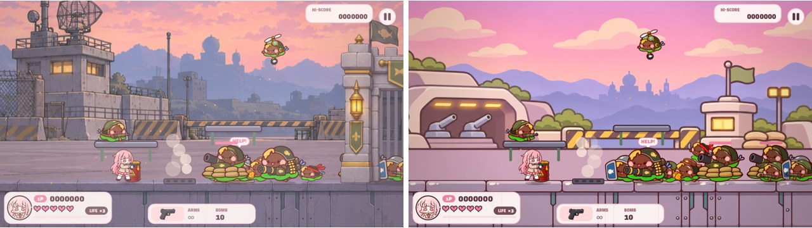
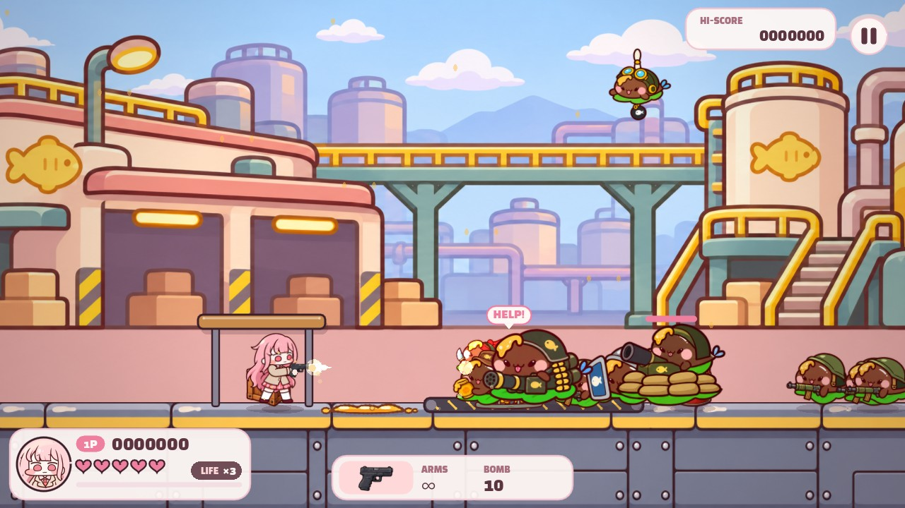
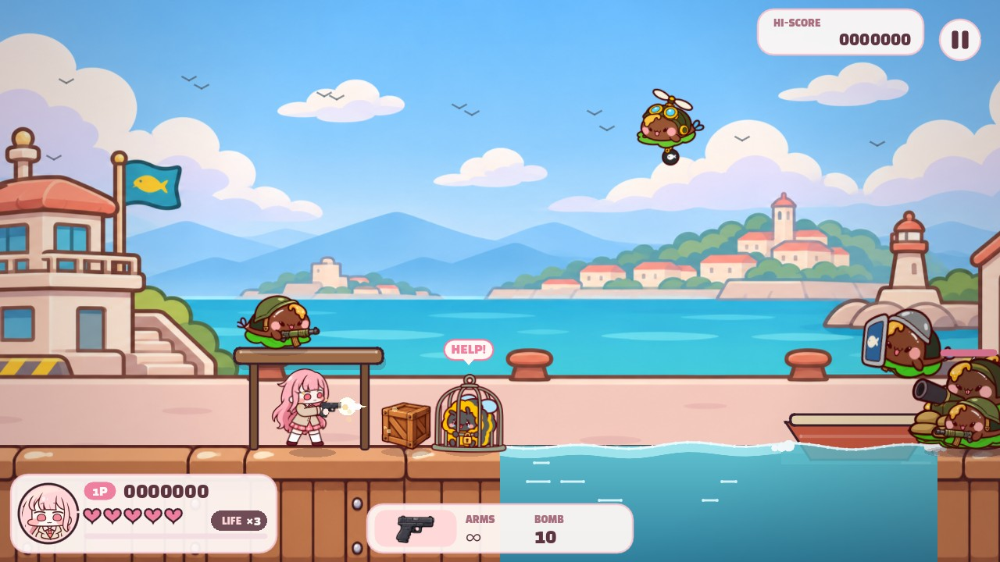
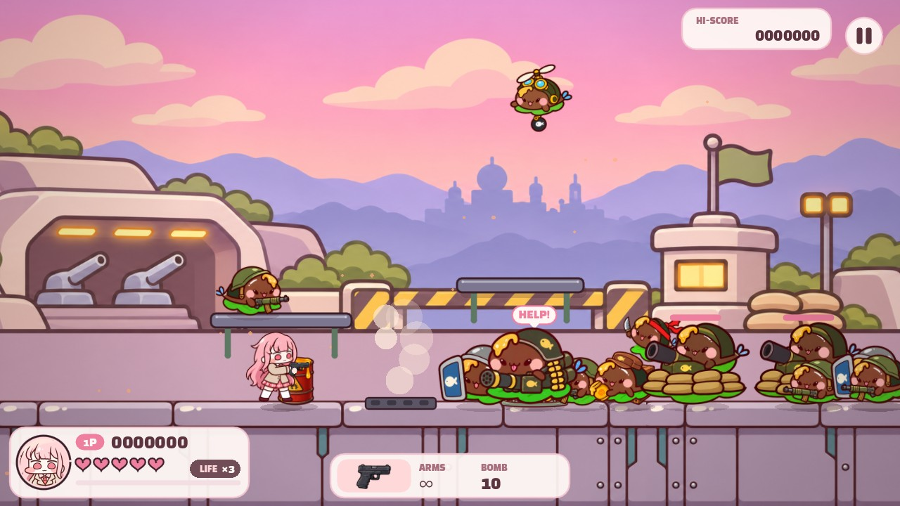
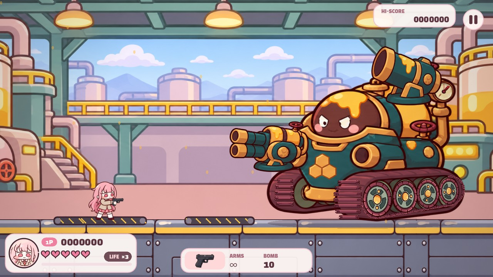

# 개발일지 — 2026-11-10

조작감 보정, 구역이 안 넘어가던 버그 수정, 인게임 배경 아트 전면 교체까지 정리한 기록입니다.
스크린샷은 모두 Godot 4.7.1 빌드에서 직접 캡처했습니다(`--capture` 모드, 1280×720).

## 1. 점프 조작감 보정

### 코요테 타임 0.1초 → 0.15초
발판 끝에서 살짝 늦게 눌러도 점프가 나가도록 유예 시간을 늘렸습니다. 60fps 기준 6프레임에서 9프레임으로 늘어난 셈입니다. 점프 선입력(착지 0.12초 전에 누른 점프)은 기존 그대로입니다.

### 아랫점프(↓ + 점프) 수정
원래 코드는 두 가지 이유로 아랫점프가 사실상 동작하지 않았습니다.
1. 점프 판정이 먼저 실행돼서 ↓ + 점프가 그냥 일반 점프가 됐습니다.
2. 발판 무시가 누른 그 한 프레임에만 적용돼서, 다음 프레임에 같은 발판에 다시 착지했습니다.

이제 발판 위에서 ↓ + 점프를 누르면 0.2초 동안 그 발판을 무시하고 아래로 떨어집니다. 지면에서는 일반 점프가 나갑니다. 컨베이어 벨트와 배는 통과할 수 없습니다(배 아래는 물이라 떨어지면 바로 죽기 때문).

## 2. 구역이 안 넘어가던 버그

**증상**: 구역을 잠그는 전투에서 적을 다 잡은 것 같은데 다음 구역으로 넘어가지 않았습니다.

**원인**: 적은 화면 밖에 있으면 아예 움직이지 않도록 되어 있습니다. 그런데 폭발에 밀려 나가거나, 낙하산으로 화면 밖에 착지하거나, 물 건너편으로 옮겨진 적은 화면 밖에서 멈춘 채 남았습니다. 이 적은 플레이어를 공격하러 오지도 않았고, 전멸 판정도 끝나지 않았습니다.

**수정**: 잠금 구역에 속한 적이 화면 밖에 있으면 화면 안으로 걸어 들어오게 했습니다. 공중에 멈춰 있던 적은 바닥에 내려놓습니다.

## 3. 인게임 배경을 캐릭터 그림체에 맞춤

실사풍 애니 배경이 2등신 카툰 캐릭터와 따로 놀아서 배경 아트를 다시 만들었습니다. Codex의 이미지 생성 기능에 기존 배경 시트와 캐릭터 일러스트(`menu_friends_v2.png`, `hero_reference.png`)를 함께 주고, 구도는 유지한 채 캐릭터 그림체로 다시 그리게 했습니다.

- **스테이지 배경 4종** (`zones_*_ink.png`): 구역별 6칸 구도, 지평선 높이, 바닥 띠 위치를 그대로 유지했습니다.
- **바닥 띠** (`ground_ink.png`): 마을 벽돌, 공장 철판, 항구 나무 데크, 요새 콘크리트 4종입니다. 마을 벽돌은 반복 이음매가 보여서 반복 너비를 1536에서 1467로 조정했습니다(`GROUND_ART`).
- **구역 입구 문** (`zone_portals.png`): 투명 배경을 유지했습니다.

공통 스타일은 굵은 갈색 외곽선, 명암 한 단계짜리 단순한 채색, 꿀색·코랄 핑크·크림·민트 계열 파스텔입니다. 캐릭터가 잘 보이도록 먼 배경은 대비를 낮췄습니다. 사용한 프롬프트는 `docs/ART_PROMPTS.txt` 끝에 있습니다.

아래 비교 이미지는 왼쪽이 이전(실사풍), 오른쪽이 이후입니다.

**마을**

**공장**

**항구**

**요새**

| 공장 | 항구 |
|---|---|
|  |  |
| **요새** | **공장 보스전** |
|  |  |

> 참고: 그 전에 했던 배경 이음매 작업(좌우 반전 대신 반복 타일, `tools/bg-seamless.py` → `backgrounds_wrap.png`)은 구역별 배경 패널로 바뀌면서 인게임에서는 더 이상 쓰이지 않습니다.

## 테스트

게임 규칙은 웹(`web/game.js`)과 Godot(`scripts/honey_game.gd`) 양쪽에 똑같이 반영했고, 회귀 테스트를 추가했습니다.

- ↓ + 점프로 발판을 통과하고, 발판 끝을 벗어난 직후에도 코요테 점프가 나가는지
- 화면 밖에 남은 잠금 구역 적이 화면 안으로 걸어 들어오는지

| 테스트 | 결과 |
|---|---|
| `node tools/test-game.cjs` | 43개 통과 |
| `node tools/test-render.cjs` | 통과 |
| Godot `tools/godot_tests/test_game.gd` | 41개 통과, 실패 0 |
